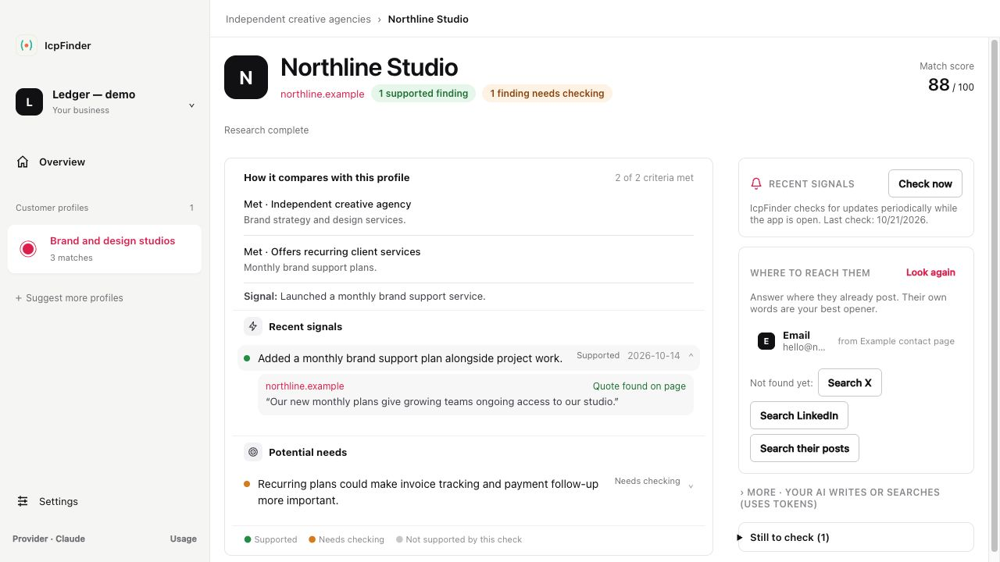
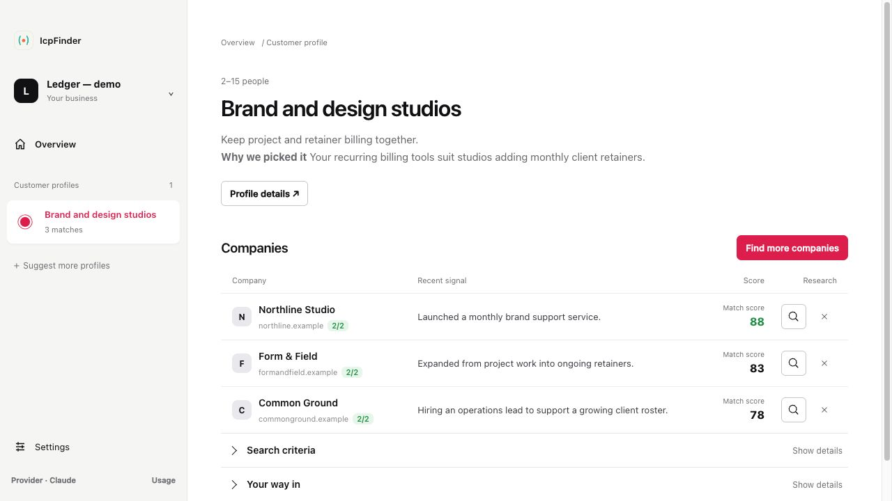

# IcpFinder

IcpFinder helps you work out who could benefit from what you offer, research companies that could fit, and find ways to reach them.

[Mac releases](https://github.com/clickspider/icpfinder/releases) · [Web app](https://icpfinder.dev) · [Web quickstart](./docs/quickstart.md) · [npm](https://www.npmjs.com/package/@icpfinder/core)



*IcpFinder for Mac. Example data shown for illustration.*

Free and open source · [MIT license](./LICENSE)

## Explore companies that could fit

See why each company could fit, then choose which ones to research further.



*Illustrative companies and signals, shown before research.*

## IcpFinder for Mac

Start with your website or a description of your business. IcpFinder suggests customer profiles you can review and refine. From there, find companies to explore, choose which ones to research, and review the sources and possible ways to reach them.

Connect your Claude, ChatGPT, or eligible Grok account to power IcpFinder. Your provider’s subscription limits apply, and access to models and tools depends on your plan. The software is free; provider subscriptions and optional services have their own requirements.

Your businesses and profiles are saved in a local workspace. Research sends relevant information to your selected provider and any services you enable. Company search is for business customer profiles; consumer profiles do not enable consumer sourcing.

[Mac releases](https://github.com/clickspider/icpfinder/releases) · [Mac setup and provider details](./packages/desktop/README.md)

Run the Mac app from source. See the [Mac setup guide](./packages/desktop/README.md) for requirements and provider setup:

```bash
git clone https://github.com/clickspider/icpfinder.git
cd icpfinder
bun install
bun run dev:desktop
```

## Web app and developer libraries

The [web app](https://icpfinder.dev) offers a separate discovery flow for suggesting customer profiles and finding contact information for candidate companies. It uses providers configured by the host or API keys you supply. See the [web quickstart](./docs/quickstart.md) for setup and requirements.

Use the TypeScript libraries to build discovery into your own application. They provide a streaming pipeline, provider interfaces, and budget controls.

## Install the libraries

```bash
# core engine + first-party adapters (Gemini + Hunter)
npm i @icpfinder/core @icpfinder/providers
# or
bun add @icpfinder/core @icpfinder/providers
# or
pnpm add @icpfinder/core @icpfinder/providers
```

Both packages include TypeScript types and use ES modules. Published packages include [npm provenance attestations](https://docs.npmjs.com/generating-provenance-statements).

## Run the web app or terminal demo

After cloning the repository and running `bun install`, try the terminal demo:

```bash
bun run demo
```

The demo uses sample data and needs no API keys. To run the web app, follow the [web quickstart](./docs/quickstart.md) to configure its environment, database, and providers before starting the development server.

## Library usage

```ts
import { IcpFinder } from "@icpfinder/core";
import { GeminiLlmProvider, HunterEmailProvider } from "@icpfinder/providers";

const finder = new IcpFinder({
  llm: new GeminiLlmProvider({ apiKey: process.env.GEMINI_API_KEY! }),
  email: new HunterEmailProvider({ apiKey: process.env.HUNTER_API_KEY! }),
});

for await (const event of finder.find({
  seed: "AI tool that helps freelance designers handle client revisions",
  archetypeLimit: 3,
  candidatesPerArchetype: 5,
  budgetCapCents: 200,
})) {
  console.log(event);
  // { type: "archetype", archetype: {...} }
  // { type: "candidate", candidate: {...} }
  // { type: "cost",      cost: { costCents, provider, endpoint } }
  // { type: "done",      totalCostCents }
}
```

## Use the web discovery tool through MCP

The web app exposes an MCP server at `https://icpfinder.dev/mcp` (Streamable HTTP, no sign-in). It has one tool, `find_icp`. Give it a product idea or URL, and it returns suggested customer profiles.

- **MCP clients:** add `https://icpfinder.dev/mcp` as a Streamable HTTP server using your client’s connector setup.
- **Claude Code:**

  ```bash
  claude mcp add --transport http icpfinder https://icpfinder.dev/mcp
  # Use your own Gemini key (provider limits and charges still apply):
  claude mcp add --transport http icpfinder https://icpfinder.dev/mcp --header "X-Gemini-Api-Key: $GEMINI_API_KEY"
  ```

Shared-key runs use the website’s limits. The MCP tool returns profiles; the [web discovery UI](https://icpfinder.dev/find) handles contact enrichment separately.

## Repository layout

```text
packages/
├── desktop/    Electron Mac app, subscription connections, local workspace
├── core/       Discovery and research orchestration
├── providers/  Provider interfaces and adapters
└── web/        Next.js web app, streaming API, MCP endpoint, persistence
```

## Usage and costs

The software is MIT licensed. AI subscriptions and external services may have their own charges and limits.

- **Mac:** research uses your connected provider account. Optional services such as Hunter have separate requirements.
- **Web and libraries:** live providers may charge for requests. Configured budgets and rate limits apply. See [web/library costs and budget controls](./docs/costs.md).

## Self-host the web app

See the [self-hosting guide](./docs/self-host.md) for web deployment and optional caching.

## Telemetry and data

The hosted website uses Vercel Web Analytics. See the [web telemetry documentation](./docs/telemetry.md) and the [Mac app’s data-storage details](./packages/desktop/README.md#data).

## Contributing

Contributions are welcome. You can report a bug, improve the documentation, or help add a provider.

- Report bugs and suggest features using the [issue templates](./.github/ISSUE_TEMPLATE).
- Discuss design changes in [GitHub Discussions](https://github.com/clickspider/icpfinder/discussions) before starting an implementation.
- For provider integrations, see the [interfaces](./packages/providers/src/types.ts) and the existing adapters and tests.

Read [CONTRIBUTING](./CONTRIBUTING.md) for development setup and pull request guidelines. The [Code of Conduct](./CODE_OF_CONDUCT.md) applies to project participation.

## Development checks

```bash
bun run test       # vitest across workspaces
bun run typecheck  # tsc --noEmit across workspaces
bun run lint       # biome
```

The CI workflow runs these checks; lint is currently informational. See the [CI workflow](./.github/workflows/ci.yml) for automated checks and [CONTRIBUTING](./CONTRIBUTING.md#releasing--versioning) for release instructions.

## Roadmap

See [ROADMAP.md](./ROADMAP.md) for planned work and [GitHub issues](https://github.com/clickspider/icpfinder/issues) for current discussions.

## Contributors

<a href="https://github.com/clickspider/icpfinder/graphs/contributors">
  
</a>

## License

Licensed under the [MIT License](./LICENSE).
